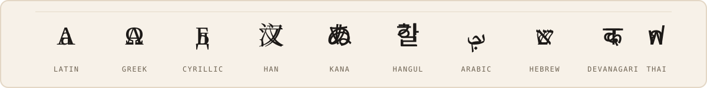

# Fontlore

Typeface intelligence for AI agents: a verified data layer, a deterministic decision engine, and 727 guides and references for choosing, pairing, and licensing fonts.

<div align="center">



[](LICENSE)
[](#whats-inside)
[](data/fonts.json)
[](data/pairings.json)
[](data/tools.json)
[](.github/workflows/validate.yml)
[](https://izynu.github.io/fontlore/)

**[Browse the live site](https://izynu.github.io/fontlore/)** - tabbed library: 9 reference categories, 165 fonts, 66 pairings, 71 tools. No build step, no tracking.



</div>

## What is Fontlore

Fontlore is an open-source typography skill built for AI agents and the humans who audit them. It contains three JSON data files (165 font records, 66 curated pairings, 71 tools), 95 curated references across 9 categories, 632 generated guides (495 per-font, 66 per-pairing, 71 per-tool), and a stdlib-only Python CLI that turns a project brief into a ranked, evidence-carrying font shortlist. Every font record carries a source URL; values that could not be verified are null rather than guessed.

The repository is designed to be loaded by an agent: SKILL.md is the entry point, MASTER-SKILL.md is the decision pipeline it implements, and scripts/decide.py is that pipeline compiled into a deterministic command. Humans get the same artifacts: the references are readable markdown, the data is inspectable JSON, and the validator that gates every commit is a single script you can read in an afternoon.

## Why it exists

- Font decisions fail on unverified facts: wrong license assumptions, missing script coverage, stale catalog data. Fontlore forces verification at the foundry source and marks everything else as null or unverified.
- AI agents need a base rate. Font fame is a weak prior; scoring on category fit, tone, coverage, and license gives a shortlist that can be defended line by line.
- Typography knowledge is scattered across foundry pages, license texts, and tribal memory. The 95 references consolidate the operational parts: constraints, licensing audits, script testing, loading pipelines.
- Open fonts deserve better metadata. The accepted license set (OFL-1.1, Apache-2.0, UFL-1.0, ITF-FFL-1.0, MIT) and the https-only, slug-keyed schema make the data layer machine-checkable.

## How the decision engine works

<div align="center">

</div>

The pipeline is a rubric, not a vibe. MASTER-SKILL.md specifies every stage; scripts/decide.py executes it deterministically; every output carries the evidence and source URL it was derived from.

## What's inside

| Directory / file | Contents | Count |
| --- | --- | --- |
| `data/fonts.json` | Font records: identity, classification, scripts, license, source URLs | 165 |
| `data/pairings.json` | Curated heading-plus-body pairings with context and rationale | 66 |
| `data/tools.json` | Tools: catalogs, APIs, inspectors, identification services | 71 |
| `references/` | Curated references in 9 categories | 95 |
| `guides/` | Generated guides (built at release time): 495 per-font + 66 per-pairing + 71 per-tool | 632 |
| `scripts/` | `decide.py` (decision engine), `validate.py` (quality gate), `build_data.py` (data builder), `generate_guides.py` (guide generator), `build_site.py` (site builder) | 5 |
| `site/` | The static website: prebuilt for GitHub Pages, tabbed library, no tracking | 732 pages |
| `SKILL.md` | Agent entry point: when to load this skill, the 8-step workflow, data schema | 1 |
| `MASTER-SKILL.md` | The decision engine document: rubric, stages, worked example, edge cases | 1 |

Reference categories: sourcing 10, selection 10, identification 10, licensing 15, scripts 10, technical 10, accessibility 10, applications 10, workflow 10. Font categories in the data: sans-serif 87, serif 42, display 16, monospace 11, handwriting 9.

## Quick start for agents

```bash
git clone https://github.com/izynu/fontlore.git
cd fontlore
# Point your agent at SKILL.md, then run the decision engine:
python3 scripts/decide.py --project dashboard --script latin --tone neutral
```

The CLI hard-filters by script and license, scores against the rubric in MASTER-SKILL.md, prints ranked reasons, and suggests curated pairings. Add `--json` for machine-readable output.

## Quick start for humans

Browse the full library with tabbed navigation at the [Fontlore website](https://izynu.github.io/fontlore/) (Fonts / Pairings / Tools / the nine reference categories), or work from this repository directly:

```bash
python3 scripts/decide.py --project marketing --script latin --tone editorial --top 8
python3 scripts/decide.py --project dashboard --script devanagari --tone neutral --json
```

Then read the references for the part of the pipeline you care about: start with `references/workflow/brief-to-constraints.md` and the licensing category.

## The website

The site lives in `site/` and is deployed to GitHub Pages by `.github/workflows/pages.yml` on every push to main. It is fully static: no cookies, no analytics, no external requests, works offline. Enable it once in repository settings (Settings > Pages > Source: GitHub Actions) and it stays in sync with the data layer automatically.

Rebuild it locally after data changes:

```bash
python3 scripts/build_site.py
```

## Repository structure

```text
fontlore/
  SKILL.md                  agent entry point
  MASTER-SKILL.md           decision engine document
  README.md
  LICENSE                   MIT
  CONTRIBUTING.md
  CODE_OF_CONDUCT.md
  SECURITY.md
  SUPPORT.md
  ROADMAP.md
  CONTRIBUTORS.md
  data/
    fonts.json              165 font records
    pairings.json           66 pairing records
    tools.json              71 tool records
  references/
    sourcing/               10
    selection/              10
    identification/         10
    licensing/              15
    scripts/                10
    technical/              10
    accessibility/          10
    applications/           10
    workflow/               10
  guides/                   632 generated guides (built at release time)
  site/                     static website (732 pages, GitHub Pages ready)
  scripts/
    decide.py               decision engine CLI
    validate.py             repository quality gate
    build_data.py           data layer builder
    generate_guides.py      guide generator
    build_site.py           site builder
  .github/
    assets/                 animated README artwork (SVG)
    workflows/              CI: validate.yml, pages.yml (deploys the site)
    ISSUE_TEMPLATE/         bug, data correction, new font, new tool forms
    PULL_REQUEST_TEMPLATE.md
    FUNDING.yml
```

## Data integrity

Every push and pull request runs `python3 scripts/validate.py`, which enforces:

- JSON parseability and a top-level count field that matches the array length.
- Required fields on every font record; licenses inside the accepted set; https-only URLs; no static font declaring variable axes.
- Pairings that reference existing font slugs, no self-pairings, no duplicate direction-agnostic pairs.
- Unique tool names and https URLs across tools.json.
- Markdown house style: pure ASCII, exactly one H1 per reference and guide, the "What this reference covers:" intro, the line-count range, 2 to 5 resolving cross-references, and the exact footer line.
- Python compilation of every script.

Policy: unverifiable values are null, never invented. Licenses are recorded as SPDX-style identifiers and verified at the font's source URL, not at aggregators. Counts are synced everywhere they appear; if a number changes in the data, it changes in this README, SKILL.md, and the site in the same commit.

## Contributing

Data corrections with evidence, new font entries with verifiable metadata, reference improvements, tool entries, and code fixes are all welcome. See CONTRIBUTING.md for the house style and the validation requirement, and open a pull request with the provided templates. Bug reports and data corrections have dedicated issue forms; questions and pairing help go to Discussions (see SUPPORT.md).

## Credits

Created by Zynu (@izynu), maintained by Shraddha (@xhraddha). Licensed MIT; see LICENSE. Font data points at each project's own source and license; the typefaces remain the property of their respective authors and foundries.

<div align="center">

<br>
<sub>Fontlore - typeface intelligence for AI agents. MIT licensed. No vibes.</sub>
</div>
